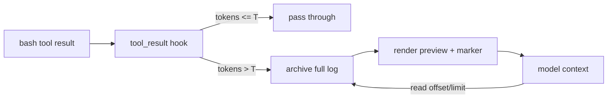

# Architecture

## Lifecycle

The hook runs once, before Pi persists the tool message:

1. Count the displayed text with the model tokenizer (`o200k_base`).
2. If it fits `T`, return nothing; Pi keeps its original result.
3. Otherwise archive the bytes and render a preview:
   - `B`: tail only.
   - `C`: head and tail, split from the same remaining budget.
4. The marker includes the omitted line-break count, exit code, archive path, and a `read` hint.
5. The final preview is re-counted; if it exceeds `T`, the budget is reduced and retried.
6. Any failure returns the original result (`fail-open`) and records a fallback reason in details.

## Budget

`T` is a **ceiling**, not an exact size. The marker is part of the text and therefore part of the budget. `B` and `C` use the same `T`; `C` does not get extra tokens for the head.

The preview is deterministic for a given archive, arm, and budget, which keeps persisted history stable across resumes.

## Archive

- If Pi already truncated and wrote `details.fullOutputPath`, the extension hard-links it into the preview directory; on `EXDEV` it falls back to a symlink.
- It reads only the first and last edge windows of the file, not the whole log.
- If Pi did not truncate, the extension writes the complete structured output itself.
- Archive file names are sequential and stable (`log-000001.txt`, ...); existing names are skipped on resume.

## Invariants

- No extra model call.
- No new model-facing tool; retrieval uses Pi's `read`.
- One replacement per tool result; no later rewriting.
- Original bytes remain on disk.
- A failed archive or render never loses the model's ability to continue.
